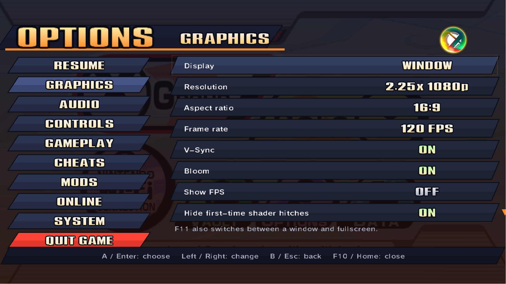
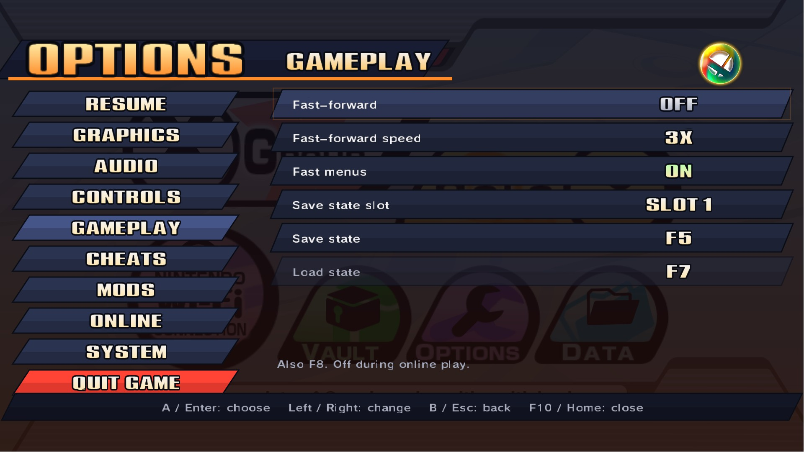
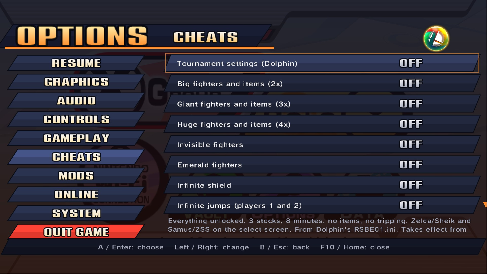
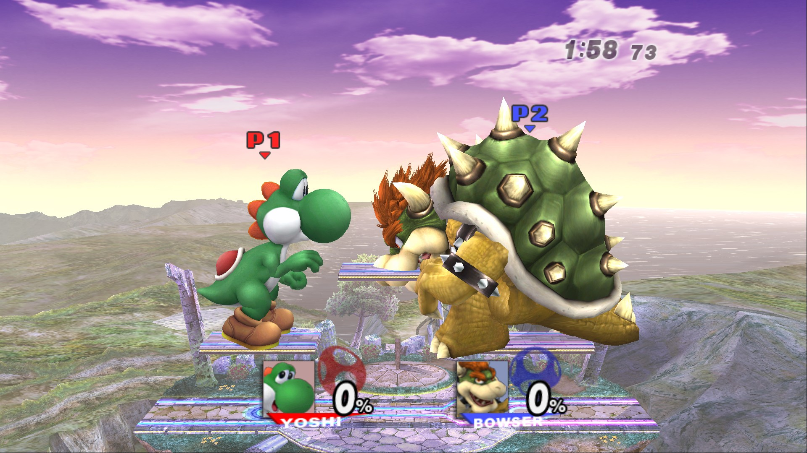
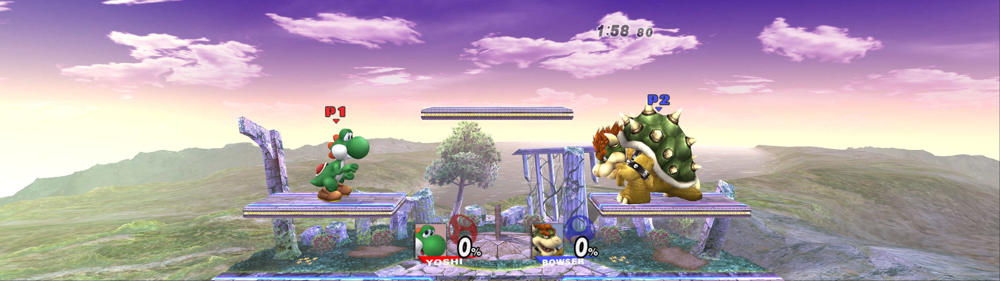

# Brawl Recompiled

A native PC port of **Super Smash Bros. Brawl** (Wii, 2008), made by statically recompiling the game's PowerPC code
(main.dol and all 126 `.rel` modules) to C++ with [WiiCompiled](https://github.com/patchzyy/Wiicompiled). No
emulator: the game runs as a Windows program.


**Work in progress.** What works today: boot, saves, every menu tested so far, VS battles, the attract demos,
Classic mode's start, and the Subspace Emissary's opening (cutscenes and the first battle). Project+ and
Project+Ex load from the virtual SD card and play matches with their own characters and stages; REX, Brawl
Minus and Legacy XP load the same way (see Mods).

## Screenshots

Rendered at 4K (shown here at 1080p).

| | |
|---|---|
|  |  |
|  |  |
|  |  |
|  |  |
|  |  |
|  |  |
|  |  |



## Features

- Up to 4K and beyond (render resolution up to 8x), the game's own 16:9, and Fill Window for ultrawide screens up
  to 32:9: more of the stage to the sides, menus and HUD kept in proportion
- 120 fps frame interpolation, on by default (180 and 240 too; the game itself runs at 60)
- An options menu inside the game, in Brawl's own style (F10, or Home on a controller): graphics, audio,
  controls, gameplay, cheats, mods, online play and updates. No separate launcher: the game starts straight away
- Save states (F5 / F7, three slots), fast-forward (F8, 2x to 4x) and fast menus
- Cheats: Gecko codes in Dolphin's format, switched on and off while you play; nine tested codes come with it
- Every gamepad is a GameCube controller, with its buttons remappable in the game (Nintendo or by-position
  layouts); keyboard and mouse for any player; real Wii Remotes over Bluetooth
- Installs from your own disc image (.iso, .ciso, .wbfs) or an already extracted game folder, and updates itself
- Saves in `UserData\NAND`, compatible in layout with a Wii's
- A virtual SD card (`UserData\SD`), so the game's own SD features and SD-based mods work
- Gecko codes and Project+-style mods (see below)
- Online play between Brawl Recompiled players (see below)
- Windows (with a build for processors without AVX2) and Linux / Steam Deck

**No game data is included**: the game's files are read from your own copy of the game.

## Mods

Brawl mods are installed the way they are on a Wii's SD card:

- **The SD card** is the folder `Play\UserData\SD`. Copy a mod's SD card contents into it (for Project+: the
  `Project+`, `private` and `apps` folders from the Wii download). At start the game gets a FAT32 card
  (`UserData\Cache\sd_card.raw`, rebuilt only when the folder changes) whose files are read straight from that
  folder, so a mod takes no extra disk space; files the game writes to the card go back into the folder when it
  exits. A card over 2 GiB is an SDHC card, which Brawl reads only with a
  mod's SDHC support (Project+ has it). A Dolphin `sd.raw` placed at `UserData\sd.raw` is used directly instead.
- **Gecko codes**: the `RSBE01.GCT` of the card folder chosen in Options > Mods ("Build to play",
  `[mods] sd_codes` in `Config.toml`), else the first folder with one (`UserData\SD\Project+\RSBE01.GCT`), else
  `UserData\Codes\RSBE01.gct`, is installed with USB Loader GX's code handler, honouring a `gc.txt` beside it
  (code list address, hook type, pokes) exactly as the mods' own loaders do: the handler runs once before the
  game's first instruction and then at every frame.
- Code the codes patch runs in a built-in PowerPC interpreter; everything else stays native. Modules a mod
  replaces (every fighter in Project+, the character select and the whole melee engine in Project+Ex and REX)
  run in the interpreter too, at full speed.

Several builds can share one card; "Build to play" picks the one that runs, and "Vanilla Brawl (no mods)" plays
the unmodded game whatever the card holds (no codes and no card). The builds tried, each copied from
its Wii (console / "hackless") download into `UserData\SD` as the folder named here:

| Build | Card folder | Get it from |
|---|---|---|
| Project+ 3.2.1 (Knuckles, Mewtwo, Roy, …) | `Project+` | [projectplusgame.com](https://projectplusgame.com) (Wii "Lite") |
| Project+Ex 1.7 (BrawlEx: Ridley, Waluigi, Sceptile, Dark Samus, …) | `P+Ex` | [KingJigglypuff/project-plus-ex](https://github.com/KingJigglypuff/project-plus-ex/releases) (Wii zip) |
| Super Smash REX Release 0½ (PMEX Remix's successor, 100+ fighters) | `rex_` | [rexbuild.site/downloads](https://www.rexbuild.site/downloads) (Wii .rar) |
| Brawl Minus 5.1.5 | `Minusery` | [brawlminus.net](https://brawlminus.net/) (Console zip) |
| Legacy XP 2.11 | `LegacyXP` | [unofficialsmashlegacy.weebly.com](https://unofficialsmashlegacy.weebly.com/legacy-xp.html) (Wii) |

Only that folder is needed (the downloads' `apps`, `private`, `codes` and loader files are for a real Wii). Setting
up the card after adding a build takes seconds (the title card shows it). Costumes, stages and movesets from [Brawl Vault](https://forums.kc-mm.com/Gallery/)
install into a build's `pf` folder exactly as on a Wii.

## Online play

Press **F9** in the game (or Options > Online):

- **Host a room** for 2 to 4 players: list it publicly, or keep it to friends, who join with its 5-letter room code.
- **Find rooms** shows public rooms, rooms on your network and rooms over [Tailscale](https://tailscale.com).
- **Join with a code** takes a friend's room code (or an IP address).
- Starting a room hands everyone the host's save and restarts every game into the match together.

Over the internet the games connect directly to each other, with no port forwarding: a free matchmaking server only
introduces them (see `server/`). A few home and mobile connections can't be reached that way; if a code never
connects, Tailscale gets around it.

Every player needs the same build: vanilla, or the same mod (the Mods page; online with a mod is new, and works best
when everyone's `UserData\SD` folder is a copy of the same download). The games run in lockstep: each
frame's controller input is all that is sent, and the games check every frame that they still match. A player's
own controller (port 1) is their player number in the room. Each frame waits for every player's input, so a slow
connection adds input delay (2 to 8 frames, picked from the ping when the room starts). Cross-play with Dolphin
(Brawl Online, Slippi-style netplay) is not possible: those run an emulator, and the games would not stay in step.

## Building from source

You need Windows, Python 3, 16 GB of RAM and your own disc image (USA, RSBE01). The toolchain is shared with the
Super Paper Mario port's `toolchain\` folder.

```powershell
# Extract your disc image to Disc\DATA, then:
copy Disc\DATA\sys\main.dol game\main.dol
# Every module pre-linked at its home, plus main_translate.dol (main.dol with the resident modules and the
# Gecko code handler) for the translation:
python wiicompiled\projects\brawl\tools\build_modules.py Disc\DATA\files\module extras\brawl-decomp\config\RSBE01_02 game\brawl_modules.rel wiicompiled game\main.dol
powershell -ExecutionPolicy Bypass -File tools\build-brawl.ps1 -SkipTools
```

`build-brawl.ps1` translates the game and compiles it into `Play\SuperSmashBrosBrawl.exe` and
`Play\engine_usa.dll` (`-SkipTranslate` recompiles only the runtime). The function map comes from the
[Brawl decompilation](https://github.com/doldecomp/brawl), cloned into `extras\brawl-decomp`.

The release (`Brawl Recompiled.exe` plus a hidden `engine\` folder) is made by `tools\build-launcher.ps1` (the
launcher, Windows and Linux, with a portable .NET SDK) and `tools\package-brawl.ps1 -Zip`; `tools\build-linux.sh`
and `tools\package-linux.sh` make the Linux download in WSL from the same translation.

| Folder | What it is |
|---|---|
| `wiicompiled/translator` | PowerPC to C++ static recompiler (C#) |
| `wiicompiled/runtime` | Runtime and Wii SDK HLE (OS, DVD, NAND, SD, WPAD/KPAD, AX audio, VI, GX) |
| `wiicompiled/aurora-main` | Aurora: Wii GX on WebGPU (Dawn / Direct3D 12) |
| `wiicompiled/projects/brawl` | This game's project: function map, module layout, code handler, tools |
| `launcher` | The launcher (WinForms; `linux\` is the same pages in Avalonia) |
| `tools` | Build and packaging scripts |

## Credits

- **Port:** JosiahG
- **[WiiCompiled](https://github.com/patchzyy/Wiicompiled)** (the recompiler and runtime) by patchzyy and
  contributors, GPLv3
- **Aurora** by Luke Street, MIT; Dawn, SDL3 and the other components listed in
  [`wiicompiled/THIRD-PARTY-NOTICES.md`](wiicompiled/THIRD-PARTY-NOTICES.md)
- **Gecko code handler:** USB Loader GX's `codehandleronly` (Gecko OS), GPL
- **[FatFs](http://elm-chan.org/fsw/ff/)** by ChaN (the SD card image), 1-clause BSD
- **Dolphin Emulator** for the reference behaviour of the SD slot and data files (DSP coefficients, Wii system
  files), GPL-2.0-or-later
- Symbol names from the [Brawl decompilation](https://github.com/doldecomp/brawl) and Dolphin's signature database

## License

GPLv3, see [`wiicompiled/LICENSE`](wiicompiled/LICENSE). Bundled third-party components keep their own licenses.

Super Smash Bros. Brawl and all related characters are trademarks and copyrights of Nintendo, HAL Laboratory and
their respective owners. This is an unofficial fan project, not affiliated with or endorsed by Nintendo. This
repository contains no game code or data; the game's disc data is read from your own copy of the game.
